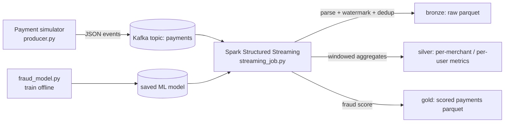

# Payment System — Real-Time Streaming + Fraud Detection

A real-time payment processing pipeline built with **Apache Kafka** and **Apache Spark Structured Streaming** (PySpark), with a machine-learning fraud detector trained in Spark MLlib. Payments flow in from a simulator, get validated and aggregated in streaming windows, and every transaction is scored for fraud before landing in the curated sink.

This is a portfolio/demo project — the data is fully synthetic.

## Architecture



## Tech stack

- Python 3.10+, PySpark 3.5 (Structured Streaming)
- Kafka (local via Docker Compose)
- Spark MLlib — Logistic Regression fraud classifier
- kafka-python producer, Parquet sinks

## Project structure

```
payment-system-spark-streaming/
├── docker-compose.yml        # Kafka + Zookeeper + Spark for local dev
├── requirements.txt
├── src/
│   ├── config.py             # shared settings, env-var overrides
│   ├── producer.py           # payment event simulator -> Kafka
│   ├── streaming_job.py      # Structured Streaming: validate, aggregate, score
│   └── fraud_model.py        # train + save the fraud classifier
├── notebooks/
│   └── fraud_analysis.ipynb  # exploratory analysis of scored output
└── data/                     # local sink output (git-ignored)
```

## Quickstart

1. Start the infra:

```bash
docker compose up -d
```

2. Install dependencies:

```bash
pip install -r requirements.txt
```

3. (Optional) Train the fraud model on synthetic data:

```bash
python src/fraud_model.py --train --output models/fraud_model
```

4. Start the payment simulator (terminal 1):

```bash
python src/producer.py --rate 20 --duration 300
```

5. Start the streaming job (terminal 2):

```bash
spark-submit src/streaming_job.py
```

Watch the console sink for per-minute aggregates and check `data/output/scored_payments` for the scored Parquet output.

## Fraud model

`fraud_model.py` trains a binary classifier on synthetic labeled payments. Features:

- transaction amount (log-scaled)
- hour of day, day of week
- merchant category risk score
- velocity: transactions by the same user in the last 10 minutes
- amount deviation from the user's rolling average

The model is a Spark ML `Pipeline` (VectorAssembler + StandardScaler + LogisticRegression) evaluated with AUC on a holdout split. The streaming job loads the saved model at startup and scores each micro-batch; a `fraud_probability` column is added and high-risk rows are also routed to a quarantine path.

> Educational demo only — not a production fraud system and not financial advice.

## Configuration

All settings live in `src/config.py` and can be overridden with environment variables, e.g. `KAFKA_BOOTSTRAP`, `PAYMENTS_TOPIC`, `CHECKPOINT_DIR`.

## Future work

- Exactly-once sinks with Delta Lake
- Online feature store for velocity features
- Model drift monitoring and scheduled retraining

## License

MIT
